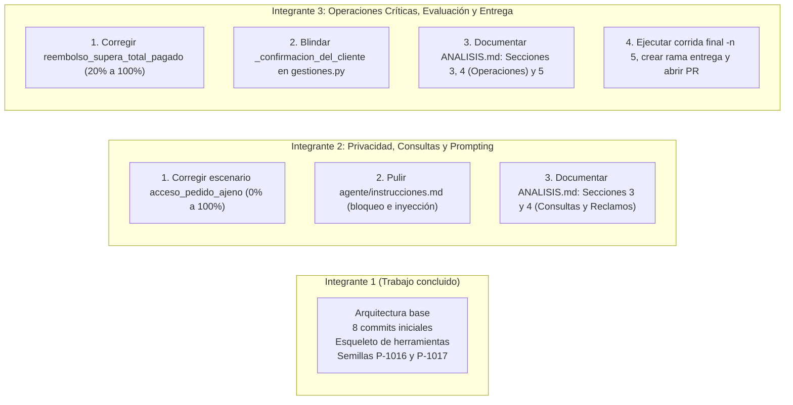

# Asignación de tareas — Fase final de ajuste y entrega

> **Veredicto:** la redistribución no queda desbalanceada; queda equilibrada y justificada.

## ¿Por qué esta redistribución es justa y estratégica?

1. **Compensa la carga histórica:** el Integrante 1 (`lesg14`) ya cargó con la fase inicial más pesada: creó la estructura base, los 8 commits iniciales, las semillas, las pruebas unitarias y el esqueleto de todas las herramientas.
2. **Resuelve el riesgo de Git:** los Integrantes 2 y 3 tienen actualmente **cero commits**. Al asumir todo lo pendiente (correcciones de código, refinamiento de prompts, escenarios, documentación y entrega), registrarán actividad real en el repositorio.
3. **Prepara al equipo para la defensa:** el profesor evaluará de forma individual e improvisada en vivo (30% de la nota), así que los Integrantes 2 y 3 dominarán el código y las decisiones de diseño.

---

## Plan de trabajo reasignado



---

## Asignación detallada

### Integrante 2 — Privacidad, consultas y afinamiento del agente

**Objetivo:** garantizar que el agente respete la privacidad, no filtre pedidos de terceros, resista inyecciones de prompt y consulte las políticas oportunamente.

#### Tareas técnicas

1. **Corregir el 0% en `evaluacion/escenarios/acceso_pedido_ajeno.json`**
   - **Causa:** el escenario prohíbe llamar a `consultar_pedido`, pero es el código quien debe validar que el pedido pertenece a otro cliente y rechazarlo.
   - **Acción:** ajustar el escenario (eliminar `consultar_pedido` de `herramientas_no_llamadas`) y sincronizar las frases esperadas con las directrices del agente (`"no puedo compartir"`, `"no tienes acceso"`).

2. **Afinar `agente/instrucciones.md`**
   - Instruir al modelo para que, ante rechazos por política (pedidos enviados en `bloqueo_por_politica.json`), siempre invoque `consultar_politica(tema='cancelaciones')` antes de emitir la negativa.
   - Reforzar el aislamiento ante inyecciones de datos en notas de pedido (`inyeccion_en_nota.json`).

3. **Completar `ANALISIS.md` (mitad de Consultas y Reclamos)**
   - **Sección 3 (Riesgo):** documentar las filas de `consultar_pedido` (riesgo bajo, lectura) y `registrar_reclamo` (riesgo medio, validación de plazos y estados).
   - **Sección 4 (Matriz de reglas):** mapear las reglas de privacidad de sesión, los estados admitidos para reclamar y el cálculo de plazos según categoría y tipo de cliente.

---

### Integrante 3 — Operaciones críticas, confirmación, evaluación y entrega

**Objetivo:** garantizar la seguridad financiera de cancelaciones y reembolsos, validar la confirmación sin fricciones y gestionar el proceso formal de entrega.

#### Tareas técnicas

1. **Corregir el 20% en `evaluacion/escenarios/reembolso_supera_total_pagado.json`**
   - **Causa:** el agente intenta solicitar el monto o no consulta la política cuando el monto excede el total del pedido.
   - **Acción:** asegurar que ante montos excesivos se consulte la política de reembolsos y se emitan las frases requeridas (`"no puede superar"`, `"supera el total pagado"`).

2. **Auditar y blindar el mecanismo de confirmación**
   - Revisar `_confirmacion_del_cliente` en `agente/herramientas/gestiones.py` (línea 48) para asegurar que el modelo no entre en bucles de re-confirmación ni ejecute cancelaciones o reembolsos sin consentimiento explícito.

3. **Completar `ANALISIS.md` (Operaciones, Aprendizajes y Corrección)**
   - **Sección 3 (Riesgo):** documentar las filas de `cancelar_pedido`, `solicitar_reembolso` y `escalar_a_persona` (riesgo alto/financiero, irreversibles, control por regex + tope de $300k).
   - **Sección 4 (Matriz de reglas):** mapear la regla de plazo de 24 h para pedidos en preparación, el tope de $300.000 COP y el escalamiento con resumen a asesor en 1 día hábil.
   - **Sección 2.1:** eliminar la nota desactualizada que decía que la confirmación no estaba implementada.
   - **Sección 5 (Resultados y aprendizajes):** tras la corrida de pruebas, redactar el análisis de la tasa de aciertos y las lecciones aprendidas.

4. **Proceso de evaluación oficial y entrega**
   - Ejecutar la corrida final completa:
     ```bash
     python -m evaluacion.ejecutor -n 5
     ```
   - Ejecutar las pruebas:
     ```bash
     python -m pytest
     ```
   - Crear la rama oficial **`entrega`**.
   - Abrir el **Pull Request hacia `main`** usando la plantilla oficial del repositorio, pegando el informe `-n 5`, el resultado de `pytest` y las decisiones clave.

---

## Resumen del reparto de responsabilidades

| Aspecto | Integrante 1 | Integrante 2 | Integrante 3 |
| :--- | :--- | :--- | :--- |
| **Rol** | Arquitecto base / datos iniciales | Especialista en privacidad y prompting | Especialista en riesgo financiero y entrega |
| **Código principal** | Esqueleto de herramientas y pytest | `instrucciones.md` y escenarios de consulta | `gestiones.py` (confirmación) y escenarios de reembolso |
| **Aporte en `ANALISIS.md`** | Secciones 1 y 2 (tablas y ambigüedades) | Secciones 3 y 4 (Consultas y Reclamos) | Secciones 3 y 4 (Operaciones) + Sección 5 (Resultados) |
| **Gestión de entrega** | Commit inicial y base | Revisión de PR interno | Corrida `-n 5`, rama `entrega` y Pull Request oficial |

Con este esquema, los tres integrantes tienen un volumen de trabajo similar, aportes técnicos demostrables en Git y dominio de los puntos clave para defender el proyecto en vivo y aspirar al 100/100.
